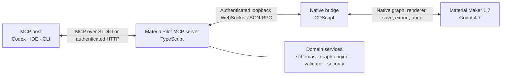

# MaterialPilot

### A native, local-first MCP bridge for editable procedural materials in Material Maker

[](https://github.com/SS-360/materialpilot/actions/workflows/ci.yml)
[](LICENSE)
[](https://github.com/RodZill4/material-maker)
[](https://godotengine.org/)
[](https://nodejs.org/)

MaterialPilot lets MCP-compatible AI agents inspect, create, organize, validate, preview, save, and
export real Material Maker projects. It works through Material Maker's native graph and undo APIs,
not UI coordinates, and keeps the procedural graph editable for artists.

The current `0.1.0` implementation preview exposes **143 typed MCP tools**, a generated catalog of
**392 Material Maker 1.7 node definitions**, revision-safe graph transactions, deterministic
validation, bounded rendering, named recovery snapshots, native undo/redo, and verified
Blender-profile PBR export.

> [!IMPORTANT]
> MaterialPilot is a tested implementation preview, not the complete `1.0` described in the
> long-range production plan. Unsupported and higher-risk operations are capability-gated instead
> of being simulated. See [Current limitations](#current-limitations).

## Why MaterialPilot?

Procedural material graphs are valuable because they remain editable, reusable, and parameterized.
Conventional text-to-texture workflows often stop at flattened images, while general desktop
automation cannot reliably understand graph ports, project revisions, renderer state, or undo
history.

MaterialPilot gives agents structured access to the underlying creative system:

- **Editable output:** the primary artifact is a native `.ptex` graph, not only exported images.
- **Native integration:** graph operations use Material Maker and Godot APIs rather than mouse
  coordinates.
- **Observation before mutation:** agents inspect the project, revision, catalog, and capabilities
  before editing.
- **Atomic changes:** a graph patch either commits as one undo step or restores its exact pre-state.
- **Deterministic safety:** schemas, port compatibility, path policy, revisions, and validation are
  enforced outside the language model.
- **Visual evidence:** live node outputs and sphere/plane previews provide bounded PNG evidence.
- **Verified delivery:** Blender exports include dimensions, file sizes, and SHA-256 hashes.
- **Local-first operation:** native communication is authenticated and bound to loopback.

## How it works



Material Maker writes an authenticated discovery record while the native bridge is running. The
MCP server reads that record, negotiates available capabilities, and connects locally. If no live
bridge is available, the server can fall back to an offline reference engine for catalog, planning,
schema, and transaction work; live-only capabilities remain false.

Every native graph mutation follows the same boundary:

```text
inspect revision -> validate patch -> snapshot -> apply operations
                 -> structural validation -> commit one undo entry
                 -> emit revision, diff, diagnostics, and evidence

failure at any point -> restore serialized snapshot -> return a structured error
```

For the design rationale, see the [architecture overview](docs/architecture/overview.md) and
[architecture decision records](docs/adr).

## Capabilities

| Area        | Current support                                                                                                     |
| ----------- | ------------------------------------------------------------------------------------------------------------------- |
| Application | Health, status, version, capability, limit, and live/offline-mode discovery                                         |
| Projects    | List, inspect, create native material tabs, save `.ptex`, and create named recovery snapshots                       |
| Catalog     | Search and inspect 392 generated Material Maker 1.7 node descriptors, ports, parameters, aliases, and compatibility |
| Graphs      | Read canonical snapshots, plan patches, dry-run, apply atomically, diff, validate, undo, and redo                   |
| Editing     | Create, delete, connect, disconnect, move, parameterize, batch-edit, comment, and expose remote controls            |
| Layout      | Semantic stages, comments, positions, selection, graph organization, and output-preserving repair workflows         |
| PBR         | Albedo, roughness, metallic, normal, height/depth, ambient occlusion, emission, and related output inspection       |
| Preview     | Bounded node-output PNGs and renderer-backed sphere/plane material previews                                         |
| Export      | Policy-constrained Blender-profile PNG/EXR maps with temporary publication and hash verification                    |
| Diagnostics | Deterministic validation, transaction history, performance inspection, structured errors, and correlation evidence  |
| Workflows   | Cracked stone, basalt, sandstone, lava, oxidized metal, and a complete abandoned-industrial-floor workflow          |

The authoritative schema and behavior for each tool are documented in the
[tool reference](docs/tools/core-tools.md).

## Safety model

MaterialPilot treats user projects, graph comments, downloaded metadata, file paths, and model
output as untrusted data.

The default security controls include:

- loopback-only native and HTTP listeners;
- an ephemeral authenticated bridge token;
- workspace read, write, and export roots;
- canonical path checks and explicit overwrite policy;
- optimistic concurrency through `expectedRevision`;
- idempotency keys for mutations and exports;
- snapshot-first transactions and rollback;
- native undo/redo integration;
- renderer-dependent capability negotiation;
- custom shader writes and network operations disabled by default; and
- stderr-only diagnostics for the STDIO MCP server.

Choose the narrowest permission mode that fits the workflow:

| Mode                   | Behavior                                                                              |
| ---------------------- | ------------------------------------------------------------------------------------- |
| `observe`              | Read-only inspection; mutations require an approval token                             |
| `assisted`             | Default; protected writes require single-use approval                                 |
| `workspace-autonomous` | Allows reversible graph editing inside approved workspace roots                       |
| `developer`            | Broader local development access; custom code and network permissions remain separate |

Read [SECURITY.md](SECURITY.md) and the [threat model](docs/security/threat-model.md) before enabling
automation in a sensitive workspace.

## Requirements

| Component      | Supported version          | Purpose                                                 |
| -------------- | -------------------------- | ------------------------------------------------------- |
| Node.js        | 22 or newer                | MCP server, CLI, packages, and tests                    |
| pnpm           | 11.9.0                     | Source builds and development                           |
| Material Maker | 1.7                        | Live procedural material editing                        |
| Godot          | 4.7 stable                 | Running or exporting Material Maker from source         |
| MCP host       | Current compatible release | Codex Desktop, Codex CLI, an IDE, or another MCP client |

The TypeScript workspace and CI target Windows, Linux, and macOS. The native compatibility suite is
pinned to Material Maker 1.7 and Godot 4.7. Renderer-backed preview and export operations require a
real Godot rendering device and are deliberately unavailable in headless sessions.

## Quick start

### 1. Build MaterialPilot

```bash
git clone https://github.com/SS-360/materialpilot.git
cd materialpilot
corepack enable
corepack prepare pnpm@11.9.0 --activate
pnpm install --frozen-lockfile
pnpm build
pnpm check
```

Run the diagnostic CLI:

```bash
node packages/cli/dist/main.js doctor
```

### 2. Install the native addon

Close Material Maker before installing or updating the addon. Copy:

```text
apps/material-maker-bridge/addon/materialpilot
```

into the Material Maker 1.7 source project as:

```text
addons/materialpilot
```

For example, in PowerShell:

```powershell
$materialPilot = 'D:\path\to\materialpilot'
$materialMaker = 'D:\path\to\material-maker-1.7'
$target = Join-Path $materialMaker 'addons\materialpilot'

New-Item -ItemType Directory -Force $target | Out-Null
Copy-Item -Path (Join-Path $materialPilot 'apps\material-maker-bridge\addon\materialpilot\*') `
  -Destination $target -Recurse -Force
```

Open the Material Maker project in Godot and enable **MaterialPilot Native Bridge** under
**Project → Project Settings → Plugins**. The plugin installs this autoload:

```ini
[autoload]
MaterialPilotBridge="*res://addons/materialpilot/bridge/bridge_server.gd"
```

Launch Material Maker normally. While it is running, the default discovery record is:

- Windows: `%USERPROFILE%\.materialpilot\bridge.json`
- Linux/macOS: `~/.materialpilot/bridge.json`

The record contains an ephemeral token. Do not publish, commit, or share it.

Verify the live bridge:

```bash
node packages/cli/dist/main.js bridge status
```

### 3. Connect an MCP client

STDIO is the recommended transport for one local client. Configure the client to launch Node with
the absolute MCP server path:

```text
node /absolute/path/to/materialpilot/apps/mcp-server/dist/main.js
```

For Codex CLI on Windows:

```powershell
codex mcp add materialpilot `
  --env MATERIALPILOT_PERMISSION_MODE=workspace-autonomous `
  -- 'C:\Program Files\nodejs\node.exe' `
  'D:\absolute\path\to\materialpilot\apps\mcp-server\dist\main.js'
```

Or add a source checkout directly to `~/.codex/config.toml`:

```toml
[mcp_servers.materialpilot]
enabled = true
command = 'C:\Program Files\nodejs\node.exe'
args = ['D:\absolute\path\to\materialpilot\apps\mcp-server\dist\main.js']
cwd = 'D:\absolute\path\to\materialpilot'
startup_timeout_sec = 10
tool_timeout_sec = 60

[mcp_servers.materialpilot.env]
MATERIALPILOT_PERMISSION_MODE = "workspace-autonomous"
```

Start Material Maker before the MCP client. If the client started first and entered offline mode,
restart it after the bridge record appears.

For packaged releases, Linux/macOS configuration, authenticated HTTP transport, and runtime-path
overrides, follow the complete [installation and run guide](docs/user/installation.md).

## Verify a live session

Ask the MCP host to inspect status before modifying anything:

```text
Use MaterialPilot's app_get_status and app_get_capabilities tools. Report whether the native
Material Maker bridge is connected, whether offline mode is active, the Material Maker and Godot
versions, the active project ID, and whether graph.read, graph.write, graph.transactions,
preview.material3d, and export.write are available. Do not change the graph.
```

A renderer-backed live session should report values equivalent to:

```json
{
  "bridgeConnected": true,
  "offlineMode": false,
  "materialMakerVersion": "1.7",
  "godotVersion": "4.7-stable"
}
```

If `offlineMode` is `true`, do not expect visible Material Maker changes. See
[Troubleshooting](docs/user/troubleshooting.md).

## Example agent workflow

```text
Using MaterialPilot, inspect the active Material Maker project and node catalog. Create an editable,
seamlessly tiling industrial floor with cracked concrete, exposed metal plates, rust, oil stains,
wetness, chipped edges, and dirt concentrated in cracks.

Create a named recovery snapshot. Organize the graph into labeled Sources, Masks, PBR Surface,
Albedo, Controls, and Output stages. Plan and dry-run the complete patch before applying it as one
revision-safe transaction. Expose artist controls for scale, crack density and depth, metal, rust,
oil, wetness, dirt, wear, and random seed. Run strict validation, render channel and sphere/plane
previews, then export verified Blender maps. Stop and report any unavailable capability or warning.
```

MaterialPilot will not infer visual success from graph validation alone. Renderer-backed previews
and exported artifacts remain separate evidence.

## Flagship production workflow

The repository includes a complete, executable **Abandoned Industrial Floor** workflow that
exercises the production path end to end:

1. catalog inspection and structured planning;
2. named recovery snapshots;
3. dry-run and atomic graph patches;
4. semantic stages, comments, and exposed controls;
5. strict deterministic validation;
6. native editable `.ptex` save;
7. 2048 × 2048 Blender channel export;
8. sphere, plane, and channel previews;
9. three controlled variations;
10. dimensions, pixel variance, file size, and SHA-256 verification; and
11. a generated Markdown material guide and artifact manifest.

Start Material Maker with the bridge enabled, choose a new artifact directory, and run:

```powershell
$env:MATERIALPILOT_ARTIFACT_ROOT = 'D:\exports\abandoned-industrial-floor-run-01'
node .\scripts\create-abandoned-industrial-floor.mjs
```

Artifact directories must be new. The workflow intentionally denies silent overwrites.

For a faster 512-resolution smoke run of the base material:

```powershell
$env:MATERIALPILOT_SMOKE = '1'
$env:MATERIALPILOT_ARTIFACT_ROOT = 'D:\exports\abandoned-industrial-floor-smoke-01'
node .\scripts\create-abandoned-industrial-floor.mjs
```

## Development and testing

### Standard repository checks

```bash
pnpm format
pnpm typecheck
pnpm lint
pnpm test
pnpm build
```

The combined typecheck, lint, and unit/integration gate is:

```bash
pnpm check
```

The suite covers schemas, stable IDs, canonical hashing, catalog compatibility, deterministic
diagnostics, transaction rollback, revision conflicts, idempotency, undo/redo, path policy,
bridge handshake, PTEX/MMPP round trips, CLI behavior, and MCP conformance.

### Godot bridge contract

Set `GODOT_BIN` to an official Godot 4.7 executable:

```powershell
$env:GODOT_BIN = 'C:\path\to\Godot_v4.7-stable.exe'
pnpm test:godot
```

This validates GDScript parsing, authenticated bridge initialization, stable IDs, handshake, and
status behavior.

### Full Material Maker contract

Install the current addon into a Material Maker 1.7 source checkout, then run:

```powershell
$env:GODOT_BIN = 'C:\path\to\Godot_v4.7-stable.exe'
$env:MATERIAL_MAKER_PROJECT = 'D:\path\to\material-maker-1.7'
pnpm test:material-maker
```

The headless contract verifies graph creation, native parameters, dry-run restoration, commit,
undo, redo, save, and safe rejection of renderer-dependent operations.

Run the GPU-backed preview and export contract with:

```powershell
$env:MATERIALPILOT_WINDOWED_TEST = '1'
pnpm test:material-maker
```

The windowed contract renders real node output, rejects empty or magenta missing-material previews,
tests sphere and plane capture, and verifies Blender export. The test window is positioned off-screen.

To run every compatible contract available in the environment:

```bash
pnpm compatibility
```

See [Building and testing](docs/development/building.md) for details.

## Repository structure

```text
materialpilot/
├── apps/
│   ├── mcp-server/              MCP transports, tool schemas, resources, and translation
│   └── material-maker-bridge/   Native Godot/Material Maker addon and contracts
├── packages/
│   ├── bridge-protocol/         Authenticated native JSON-RPC client and schemas
│   ├── cli/                     Doctor, bridge health, lint, and normalization commands
│   ├── domain/                  Stable public graph, patch, diagnostic, and capability model
│   ├── graph-engine/            Offline transactions, revisions, idempotency, undo, and redo
│   ├── mmpp/                    Material Maker painting-project adapter
│   ├── node-catalog/            Generated and stable node descriptors
│   ├── ptex/                    Procedural texture project parsing and round trips
│   ├── security/                Permission, audit, canonical path, and workspace policy
│   └── validator/               Deterministic structural and PBR validation
├── docs/                        Architecture, ADRs, guides, security, and tool reference
├── fixtures/                    Compatibility and serialization fixtures
├── schemas/                     Published JSON-compatible schemas
└── scripts/                     Compatibility, release, SBOM, and production workflows
```

Architecture boundaries are intentional:

- `apps/mcp-server` owns MCP transport and translation only.
- `apps/material-maker-bridge` owns Godot and Material Maker integration only.
- `packages/domain` never exposes Godot objects.
- `packages/graph-engine` owns transactions and revision semantics.
- `packages/validator` remains deterministic and LLM-independent.
- `packages/security` owns path and permission decisions.

## Current limitations

The following capabilities are intentionally unavailable or incomplete in `0.1.0`:

- native project open and close mutations;
- export profiles beyond Blender and engine-specific packaging;
- arbitrary panel capture, histogram automation, and automated perceptual comparison;
- asset-library installation and community network operations;
- arbitrary subgraph mutation and generated custom shader writes;
- painting mutations and automated strokes; and
- remote or multi-user deployment beyond authenticated loopback HTTP.

Painting data is inspection-only, and custom shader writes remain disabled. Renderer-backed
features are unavailable under Godot's headless/dummy renderer. These are explicit capability
results, not silent fallbacks.

See the [implementation status](docs/development/implementation-status.md) and
[production implementation plan](materialpilot-production-implementation-plan.md) for the roadmap
and stable `1.0` definition.

## Documentation

- [Installation and run guide](docs/user/installation.md)
- [First material](docs/user/first-material.md)
- [Troubleshooting](docs/user/troubleshooting.md)
- [Tool reference](docs/tools/core-tools.md)
- [Implementation status](docs/development/implementation-status.md)
- [Architecture overview](docs/architecture/overview.md)
- [Transaction model](docs/architecture/transactions.md)
- [Material Maker 1.7 integration map](docs/architecture/upstream-1.7-map.md)
- [Building and testing](docs/development/building.md)
- [Security threat model](docs/security/threat-model.md)

## Contributing

Contributions are welcome. Start with [CONTRIBUTING.md](CONTRIBUTING.md), preserve the package
boundaries above, and include tests and documentation with behavior changes.

Before opening a pull request:

```bash
pnpm install --frozen-lockfile
pnpm format
pnpm check
pnpm build
```

Native bridge changes must also pass `pnpm test:godot` and the affected Material Maker contract.
Mutations require optimistic concurrency, an idempotency key, transaction/rollback support, a
schema, documentation, tests, and a threat classification.

## Security

Report vulnerabilities privately to the maintainers. Never attach private projects, bridge tokens,
HTTP bearer tokens, exported proprietary textures, or logs containing sensitive paths to a public
issue. See [SECURITY.md](SECURITY.md) for the supported disclosure process.

## License

MaterialPilot is licensed under the [Apache License 2.0](LICENSE). Material Maker remains an
independent upstream project distributed under its own license; retain upstream notices when
redistributing integrated builds.

## Acknowledgements

MaterialPilot builds on [Material Maker](https://github.com/RodZill4/material-maker),
[Godot Engine](https://godotengine.org/), and the
[Model Context Protocol](https://modelcontextprotocol.io/). The project is designed to complement
Material Maker's artist-facing workflow while preserving editable graphs and human control.
